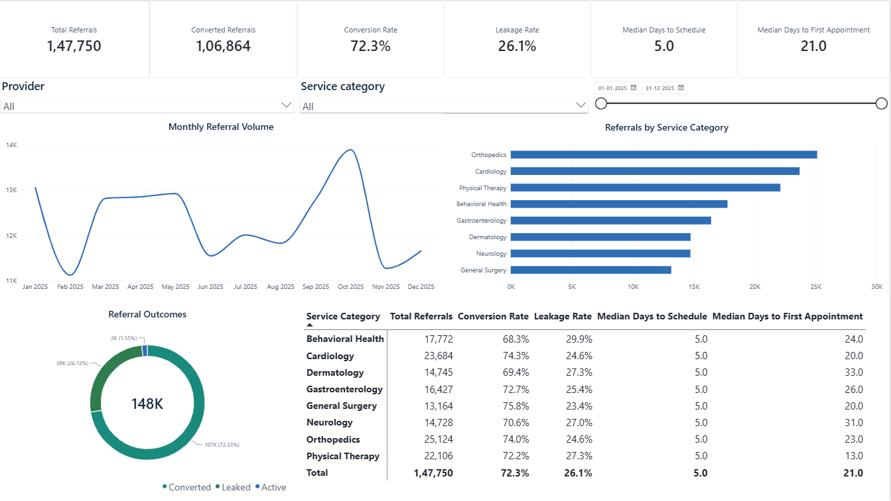
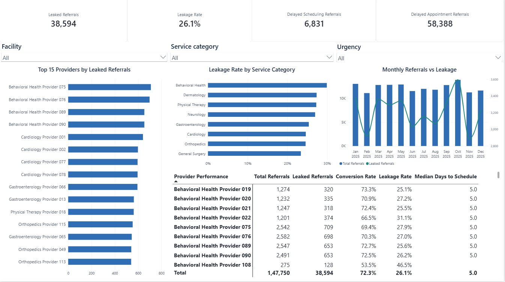
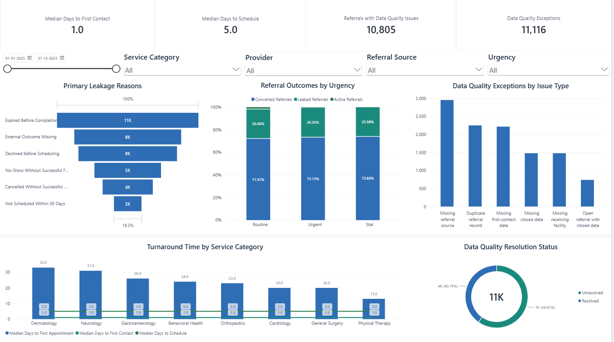

# Healthcare Referral Leakage Analytics

An end-to-end analytics project that follows specialist referrals from creation through
contact, scheduling and appointment outcome to show where referrals are lost. It covers
referral leakage, delays, cancellations, no-shows, duplicates and data-quality gaps across
service categories, facilities and patient segments. The project uses Python, Pandas, SQL
(SQLite) and Power BI.

> **Synthetic data and non-clinical use notice**
>
> Every record in this project is **fully synthetic and fictional**. It is produced by a
> seeded random-number generator and contains no real patient information, medical
> records or external healthcare datasets. Patients have no names, contact details,
> addresses, diagnoses or clinical notes. Facility and provider names are invented, and
> any resemblance to real organisations or people is coincidental. All rates and
> benchmarks are illustrative generator settings, not real-world statistics.
>
> This project is for **portfolio and educational use only**. It must not be used for
> clinical decision-making, patient care or real operational decisions.

## Project objectives

- Generate a realistic, reproducible synthetic referral dataset of 150,000 referral records.
- Clean and validate the raw data and load it into a SQLite database.
- Define transparent rules for referral leakage, delays and operational exceptions.
- Calculate referral conversion, turnaround times and leakage points with SQL and Python,
  and reconcile the KPIs between the two.
- Present the results in a Power BI dashboard for process-improvement discussions.

## Technology stack

| Area | Tools |
| --- | --- |
| Data generation and cleaning | Python 3.12, Pandas, NumPy |
| Database and analytics | SQL, SQLite |
| Dashboard | Power BI Desktop (DAX) |
| Testing | pytest |

## Project phases

| Phase | Scope | Status |
| --- | --- | --- |
| 1 | Project setup and deterministic synthetic-data generator | Complete |
| 2 | Data cleaning, validation and SQLite pipeline | Complete |
| 3 | Referral-leakage rules, SQL analytics and KPI reconciliation | Complete |
| 4 | Power BI data package, DAX measures, theme, build guide and dashboard | Complete |
| 5 | Final testing, screenshots, documentation and GitHub QA | Planned |

## Synthetic data model

The generator writes six raw CSV files. Identifiers are stable text codes.

```
service_categories (SVC###) ─┐
facilities (FAC###) ─────────┼─< providers (PRV###)
                             │
patients (PAT######) ────────┴─< referrals (REF#######) ─< appointments (APT#######)
```

- Each provider belongs to one facility and one service category.
- Each referral names a patient, a service category, a receiving facility and a receiving
  provider who works at that facility in that service category.
- A referral can have zero, one or several appointments. Several appointments happen when
  an appointment is rescheduled, or when a cancellation or no-show is rebooked.
- Appointments always reference a valid referral ID.
- Referrals sent to out-of-network facilities leave the system and have no appointments.
  Some return a confirmed outcome; the rest have no recorded outcome.

### Reporting period

- Referral dates fall within the reporting year **2025-01-01 to 2025-12-31**.
- Follow-up activity (contact, booking, appointments, closure) is captured up to the
  **data extract date of 2026-01-31**, so late-year referrals can still show progress.
- Appointments booked on or before the extract date for a later date have the status
  `Scheduled`.
- A referral that is not booked within 90 days expires.

### Referral lifecycle

| referral_status | Meaning |
| --- | --- |
| Completed | An appointment was completed |
| Scheduled | An appointment is booked after the extract date |
| Pending | Open, awaiting contact, booking or rebooking |
| Declined | The patient declined or chose another provider |
| Cancelled | The last appointment was cancelled or missed and not rebooked |
| Expired | Not booked within the 90-day referral window |
| Sent External | Referred to an out-of-network facility |

Appointment statuses are `Completed`, `Cancelled`, `No-Show`, `Rescheduled` and `Scheduled`.

### Controlled data-quality issues

A small, fixed share of rows contains deliberate problems for Phase 2 to detect and clean.
The rates are set in `config.py`. Most rows are valid, and the generator never creates
impossible foreign keys or malformed CSV rows.

| Issue | Rate | How it appears |
| --- | --- | --- |
| Duplicate referral ID | 1.5% of referral rows | Exact copy of a referral's business fields with a new `referral_record_id` |
| Missing referral source | 2.0% of unique referrals | `referral_source` is blank |
| Missing receiving facility | 1.0% of unique referrals | `receiving_facility_id` is blank (the provider is still recorded) |
| Missing first-contact date | 1.5% of unique referrals | Blank although the referral has an appointment or was declined |
| Missing closure date | 1.0% of unique referrals | Closure reason recorded but `closed_date` is blank |
| Inconsistent closure | 0.5% of unique referrals | `Pending` or `Scheduled` referral with a `closed_date` |

Some fields are blank by design rather than through data-quality issues. For example,
`first_contact_date` is blank when a patient was never reached, `closure_reason` and
`closed_date` are blank for open referrals, and `status_reason` is filled only for
cancelled or rescheduled appointments.

## Setup and data generation (Windows PowerShell)

Run these commands from the project folder. They need Python 3.12.

```powershell
py -3.12 -m venv .venv
.\.venv\Scripts\python.exe -m pip install -r requirements.txt
```

Generate the default dataset of 150,000 referral rows with seed 42:

```powershell
.\.venv\Scripts\python.exe generate_data.py
```

Or set the referral count and seed explicitly:

```powershell
.\.venv\Scripts\python.exe generate_data.py --referrals 150000 --seed 42
```

Options:

| Option | Default | Description |
| --- | --- | --- |
| `--referrals` | 150000 | Rows in `referrals.csv`, including duplicate rows (1 to 1,000,000) |
| `--seed` | 42 | Random seed; the same seed gives byte-identical files |
| `--output-dir` | `data\raw` | Folder for the generated CSV files |

The generator prints the output folder, the seed, the reporting period and the row count
for every file. Generating 150,000 referrals takes about 15 seconds. Generated data files
are ignored by Git and can be recreated at any time.

## Generated files

All files are written to `data\raw` as UTF-8 CSV with `\n` line endings. Dates use
`YYYY-MM-DD`, date-times use `YYYY-MM-DD HH:MM:SS`, and missing values are empty fields.

| File | Rows (default run) | Description |
| --- | --- | --- |
| `service_categories.csv` | 8 | Service categories, service line and an illustrative target days to appointment |
| `facilities.csv` | 12 | Fictional facilities with type, region and network status (10 in-network, 2 out-of-network) |
| `providers.csv` | 132 | Fictional providers with provider type, facility and service category |
| `patients.csv` | 60,000 | Age group, gender, insurance type and home region only |
| `referrals.csv` | 150,000 | One row per referral record, including controlled duplicates (147,750 unique referral IDs) |
| `appointments.csv` | 128,718 | Appointment attempts per referral, with booking date, appointment date-time, status and reason |

### Referral columns

| Column | Description |
| --- | --- |
| `referral_record_id` | Unique row identifier, also unique across duplicate rows |
| `referral_id` | Business referral identifier (repeated on duplicate rows) |
| `patient_id`, `service_category_id` | Patient and requested service |
| `receiving_facility_id`, `receiving_provider_id` | Destination facility and provider |
| `referral_source` | Primary Care, Specialist, Emergency Department, Hospital Discharge, Urgent Care or Patient Portal |
| `urgency` | Routine, Urgent or Stat |
| `referral_date`, `first_contact_date` | Referral creation date and first successful patient contact |
| `referral_status`, `closure_reason`, `closed_date` | Status on the extract date and closure details |

### Appointment columns

| Column | Description |
| --- | --- |
| `appointment_id`, `referral_id`, `appointment_sequence` | Appointment identifier, referral and attempt number (1, 2, ...) |
| `facility_id`, `provider_id` | Where and with whom the appointment was booked |
| `booked_date`, `appointment_datetime` | When it was booked and when it was planned to take place |
| `appointment_status`, `status_reason` | Outcome, plus the reason for cancellations and reschedules |

## Data preparation (Phase 2)

Phase 2 validates the raw files, cleans the controlled data-quality issues, and builds a
SQLite database for analysis. Run it after generating the raw data:

```powershell
.\.venv\Scripts\python.exe prepare_data.py
```

If the raw files are missing, the script stops and shows the generation command. The
`--raw-dir`, `--processed-dir` and `--output-dir` options change the input and output
folders. They default to `data\raw`, `data\processed` and `data\output`.

The pipeline works in this order:

1. **Load:** read the six raw CSVs as text and enforce a strict schema. A missing column
   or an unexpected extra column stops the run.
2. **Standardize:** trim whitespace, treat blank text as missing, and normalize dates to
   `YYYY-MM-DD` and date-times to `YYYY-MM-DD HH:MM:SS`. Raw dates may use `-` or `/`;
   any other date format is rejected.
3. **Validate:** run 35 structural checks covering:
   - required values, identifier formats and unique keys;
   - the duplicate design (at most two identical rows per referral ID);
   - foreign keys and provider–facility–service consistency;
   - allowed category values and numeric ranges;
   - reporting-year and extract-date limits, date ordering and appointment journeys;
   - status and closure consistency.

   Any failure is a **fatal structural error**. The run stops, exits with code 1, and
   writes a failed JSON report. The previous successful CSVs and database are left
   unchanged.
4. **Clean:** apply the rules below and record every controlled issue as an exception.
5. **Publish:** build all outputs in a temporary folder inside `data\output`, create the
   database from `sql\01_create_schema.sql`, and check foreign keys and row counts.
   Only then are the outputs moved into place.

### Cleaning rules

| Issue | Rule | Exception status |
| --- | --- | --- |
| Leading or trailing whitespace | Trimmed | Resolved |
| Non-ISO date format (e.g. `2025/03/05`) | Normalized to ISO | Resolved |
| Duplicate referral ID | Keep the row with the smallest `referral_record_id`; log each removed row | Resolved |
| Blank referral source | Replaced with `Unknown` | Unresolved (true source unknown) |
| Blank receiving facility | Inferred from the receiving provider's facility when it is unambiguous; otherwise left blank | Resolved, or Unresolved if not inferred |
| Blank first-contact date where an appointment or decline proves contact | Kept blank; no date is invented | Unresolved |
| Closure reason without a closed date | Kept blank; closure reason retained | Unresolved |
| Open referral (`Pending`/`Scheduled`) with a closed date | Closed date cleared | Resolved |

Some blanks are part of the design and are kept without being flagged:
- patients who were never contacted;
- open referrals with no closure details;
- `status_reason` on appointments that were not cancelled or rescheduled.

### Data-quality exceptions

`data_quality_exceptions.csv` has one row per detected issue, with these columns:

| Column | Description |
| --- | --- |
| `exception_id` | Stable ID (`DQE0000001`, ...) |
| `entity_type` | Kind of record the issue was found on |
| `record_id` | Raw row identifier (for referrals, the `referral_record_id`) |
| `referral_id` | Related referral ID |
| `issue_type` | What was wrong |
| `field_name` | Affected field |
| `original_value` | Value before cleaning |
| `cleaned_value` | Value after cleaning |
| `action_taken` | Cleaning action applied |
| `resolution_status` | `Resolved` or `Unresolved` |

Processed referrals carry three summary fields:
- `duplicate_record_count`: duplicate rows removed for that referral;
- `data_quality_issue_count`: number of exceptions linked to the referral;
- `has_data_quality_issue`: 1 if the referral has any exceptions, otherwise 0.

These support data-quality analysis in Power BI later. Phase 2 does not add leakage flags
or KPIs; those are defined in Phase 3.

### Phase 2 outputs (default run)

| Output | Rows | Description |
| --- | --- | --- |
| `data\processed\service_categories.csv` | 8 | Validated master data |
| `data\processed\facilities.csv` | 12 | Validated master data |
| `data\processed\providers.csv` | 132 | Validated master data |
| `data\processed\patients.csv` | 60,000 | Validated master data |
| `data\processed\referrals.csv` | 147,750 | One row per unique referral ID; raw columns plus the three data-quality fields |
| `data\processed\appointments.csv` | 128,718 | Validated appointments plus a derived `appointment_date` |
| `data\processed\data_quality_exceptions.csv` | 11,116 | One row per detected data-quality issue |
| `data\output\healthcare_referrals.db` | 7 tables | SQLite database with the same seven tables |
| `data\output\phase2_data_quality.json` | — | Validation and data-quality report |

The default run removes 2,250 duplicate rows. It records these exceptions:

| Exception | Count |
| --- | --- |
| Duplicate referral row removed | 2,250 |
| Referral source replaced with `Unknown` | 2,955 |
| Receiving facility inferred from provider | 1,478 |
| First-contact date kept blank | 2,216 |
| Closed date kept blank | 1,478 |
| Closed date cleared on open referral | 739 |

These counts match the generator's configured data-quality targets, and the run reports
no structural violations.

### SQLite database

- **Schema:** `sql\01_create_schema.sql` drops and recreates the seven tables, so it is
  safe to rerun.
- **Keys:** foreign keys are enabled. Every table has a primary key, and the schema adds
  unique constraints such as `referral_record_id` and (`referral_id`,
  `appointment_sequence`).
- **CHECK constraints:** these cover allowed category values, 0/1 flags and date order,
  and require that open referrals have no closed date after cleaning.
- **Indexes:** these cover referral date, status, service category, facility, provider,
  patient, source and urgency, plus appointment referral, status, date, facility and
  provider.
- **Types:** identifiers, categories and ISO dates are TEXT; counts and flags are INTEGER.
- **Post-load checks:** after loading, the pipeline confirms `PRAGMA foreign_key_check`
  returns no rows, `PRAGMA integrity_check` returns `ok`, and every table's row count
  matches its processed CSV.

Phase 3 adds its analytical views to this database (see [Analytics (Phase 3)](#analytics-phase-3)).

### JSON report

`phase2_data_quality.json` contains:
- the pipeline status;
- the synthetic-data and non-clinical-use notice;
- the reporting period and extract date;
- input and output row counts and duplicate counts;
- missing values per approved field, before and after cleaning, separating flagged
  exceptions from legitimate blanks;
- cleaning actions and exception counts, including unresolved exceptions;
- a reconciliation against the generator's data-quality targets;
- every validation check and its result;
- referral and appointment status counts;
- database row counts and the foreign-key check result.

The report contains no timestamps or machine-specific paths.

### Deterministic rebuilds

Running `prepare_data.py` again on unchanged raw data produces byte-identical processed
CSVs and an identical JSON report. The database is rebuilt from scratch with identical
table contents. Outputs use stable sort orders, UTF-8, `\n` line endings, and empty fields
for missing values.

## Analytics (Phase 3)

Phase 3 adds the analytics layer that the Power BI dashboard will use later. It consists of
SQL views in the Phase 2 database, automated KPI reconciliation, and deterministic CSV
exports. Run it after Phase 2:

```powershell
.\.venv\Scripts\python.exe analyze_data.py
```

The script runs in this order:

1. It checks that `data\output\healthcare_referrals.db` exists and that the last Phase 2
   run succeeded. If either check fails, it stops with the commands to run first.
2. It creates or refreshes the views from `sql\02_create_analytics_views.sql`. The script
   only drops and recreates its own views and never changes the Phase 2 tables.
3. It queries every view and runs 26 reconciliation checks.
4. If every check passes, it writes the exports and `phase3_analytics_summary.json` to
   `data\output`.

If a check fails, the script exits with code 1, names the failed check, and writes a failed
summary. The exports from the last successful run are left unchanged. A full run takes
about 100 seconds on the standard dataset.

### Leakage and conversion definitions

Every definition is documented in [sql/KPI_DEFINITIONS.md](sql/KPI_DEFINITIONS.md) and is
implemented exactly as documented in SQL. The definitions use the extract date
(2026-01-31) and a 30-day follow-up window.

- **Converted:** the referral has a completed appointment, **or** it was `Sent External`
  with a confirmed external visit.
- **Active / in progress:**
  - the referral is not converted, **and**
  - it has a future appointment, **or** its last open item is less than 30 days old
    (not yet booked, awaiting rebooking, or awaiting an external outcome).
- **Leaked:** the referral is neither converted nor active, and it matches one rule. The
  first matching rule in priority order is its single `primary_leakage_reason`:
  1. External Outcome Missing
  2. Expired Before Completion
  3. Cancelled Without Successful Rebooking (the last appointment was cancelled)
  4. No-Show Without Successful Follow-Up (the last appointment was a no-show)
  5. Declined Before Scheduling
  6. Not Scheduled Within 30 Days
- **Conversion Rate** and **Leakage Rate** both divide by total referrals. They are not
  forced to add up to 100%, because active referrals are neither.

**Referral-level vs appointment-level:**
- Referral-level measures count each referral once. For example, `cancelled_referrals` is
  the number of referrals with at least one cancellation.
- Appointment-level measures count appointment rows and always have `appointment` in their
  name, for example `cancelled_appointments` and `appointment_no_show_rate`.
- Appointments are aggregated per referral before joining, so a referral with several
  appointments is never counted twice.

### SQL views

| View | Description |
| --- | --- |
| `vw_referral_journey` | One row per referral, with:<ul><li>patient segment, service, facility and network status;</li><li>appointment summary;</li><li>turnaround days;</li><li>conversion, active, leakage and delay flags;</li><li>the primary leakage reason;</li><li>Phase 2 duplicate and data-quality counts.</li></ul> |
| `vw_overall_kpis` | One row of overall referral-level and appointment-level KPIs |
| `vw_referral_funnel` | Total → Contacted → Scheduled → Completed or Confirmed External Outcome, split into internal and external |
| `vw_monthly_metrics`, `vw_service_category_metrics`, `vw_facility_metrics`, `vw_referral_source_metrics`, `vw_urgency_metrics`, `vw_insurance_metrics` | The same metric set for each group: counts, rates, delays, data-quality counts, and average and median turnaround |
| `vw_leakage_reason_metrics` | Leaked referrals per reason in priority order, with share of leaked referrals and rate of all referrals |
| `vw_turnaround_metrics` | Eligible count, average, median, minimum and maximum days per turnaround measure |
| `vw_data_quality_metrics` | Phase 2 exceptions per issue type, with resolved, unresolved and affected-referral counts |
| `vw_analysis_parameters`, `vw_leakage_reasons`, `vw_appointment_summary`, `vw_analysis_dimensions`, `vw_journey_by_dimension`, `vw_dimension_metrics` | Helper views |

How the views behave:
- **Grouped views:** all of them share one calculation in `vw_dimension_metrics`. Missing
  categories are labelled `Unknown`, so each grouped view sums to the overall totals.
- **NULL values:** a rate is NULL when its denominator is zero. A turnaround measure
  ignores missing dates instead of treating them as zero.
- **Medians:** these are computed in SQL from the frequency distribution, using a running
  total over each whole-day value.

### Exports

All exports are written to `data\output` (ignored by Git). They use UTF-8, `\n` line endings
and empty fields for NULL, and decimals have 6 places.

| File | Rows (default run) |
| --- | --- |
| `referral_journey.csv` | 147,750 |
| `overall_kpis.csv` | 1 |
| `referral_funnel.csv` | 4 |
| `monthly_metrics.csv` | 12 |
| `service_category_metrics.csv` | 8 |
| `facility_metrics.csv` | 12 |
| `referral_source_metrics.csv` | 7 |
| `urgency_metrics.csv` | 3 |
| `insurance_metrics.csv` | 4 |
| `leakage_reason_metrics.csv` | 6 |
| `turnaround_metrics.csv` | 3 |
| `data_quality_metrics.csv` | 6 |
| `phase3_analytics_summary.json` | Overall KPIs, funnel, leakage reasons, turnaround and all reconciliation results; no timestamps |

Rerunning on the same database produces byte-identical exports and summary.

### Reconciliation checks

The 26 checks confirm that:
- **Journey grain:** the journey has one row per referral, and the totals match the
  `referrals` table.
- **Outcome flags:**
  - no referral is both converted and leaked, both active and leaked, or both converted
    and active;
  - every leaked referral has exactly one reason, and no other referral has one;
  - the leakage-reason counts and outcome categories add up;
  - every leakage reason agrees with its condition: for example, "Not Scheduled Within 30
    Days" requires zero appointments and `scheduled_flag = 0`;
  - every non-converted referral with a future Scheduled appointment is active and never
    leaked.
- **Grouped totals:** every grouped view sums to the overall totals.
- **Status and appointment counts:** these match the base tables.
- **Rates:** every rate uses its documented numerator and denominator, and stays between
  0 and 1.
- **Turnaround:** averages and medians match an independent Python calculation over
  nonmissing values.
- **Phase 2 reconciliation:** duplicate and data-quality counts match the Phase 2 tables
  and report.
- **Funnel:** stages follow their definitions.
- **Durations:** no duration is negative.
- **Zero denominators:** rates return NULL rather than 0.
- **Exports:** every export keeps its documented columns and sort order.

### Seed-42 results

These results describe the **synthetic** dataset generated with seed 42. They reflect the
generator settings in `config.py`, not real healthcare performance.

| KPI | Value |
| --- | --- |
| Total referrals | 147,750 |
| Converted | 106,864 (72.3%): 97,197 completed internally and 9,667 confirmed externally |
| Leaked | 38,594 (26.1%) |
| Active / in progress | 2,292 (1.6%) |
| Unclassified | 0 |
| Scheduling rate | 73.5% |
| Completion rate | 65.8% |
| Referrals with a cancellation (referral-level) | 9,568 (6.5%) |
| Referrals with a no-show (referral-level) | 9,959 (6.7%) |
| Cancelled appointments (appointment-level) | 10,092 of 128,718 (7.8%) |
| No-show appointments (appointment-level) | 10,528 of 128,718 (8.2%) |
| Median / average days to first contact | 1 / 2.0 |
| Median / average days to first booking | 5 / 8.4 |
| Median / average days to first appointment | 21 / 27.1 |

The active referrals are the 2,167 `Scheduled` referrals with future appointments, plus 125
`Pending` referrals awaiting rebooking after a recent cancellation or no-show. The 2,167
"Not Scheduled Within 30 Days" referrals are a different group: `Pending` referrals with no
appointment at all. The two counts are equal by coincidence for seed 42; other seeds give
different counts.

| Leakage reason | Referrals | Share of leaked |
| --- | --- | --- |
| External Outcome Missing | 8,399 | 21.8% |
| Expired Before Completion | 11,111 | 28.8% |
| Cancelled Without Successful Rebooking | 3,942 | 10.2% |
| No-Show Without Successful Follow-Up | 5,233 | 13.6% |
| Declined Before Scheduling | 7,742 | 20.1% |
| Not Scheduled Within 30 Days | 2,167 | 5.6% |

Funnel: 147,750 total → 139,339 contacted (94.3%) → 108,664 scheduled (73.5%) → 106,864
completed or confirmed externally (72.3%). Stage 4 includes 9,667 external referrals that
skip internal scheduling.

Observations from the synthetic data:

- **Network status:** referrals to the two out-of-network facilities convert at about
  53–54%, against 70–78% for in-network facilities. Their leakage comes mainly from
  missing external outcomes.
- **Service category:** leakage is highest in Behavioral Health (29.9%) and lowest in
  General Surgery (23.4%).
- **Referral source:** Emergency Department (30.6%), Patient Portal (29.2%) and Urgent Care
  (28.9%) referrals leak more than Specialist (24.2%) and Primary Care (25.0%) referrals.
- **Insurance:** Self-Pay referrals have the highest leakage rate (30.1%). Medicare
  referrals have the lowest (24.9%).
- **Urgency:** Stat referrals reach a first appointment faster than Routine ones (median 7
  days against 26).
- **Recent months:** December 2025 shows a lower conversion rate (57.3%) because 1,754 of
  its referrals are still active at the extract date. This is the reason active referrals
  are kept separate from leakage.
- **Delayed appointments:** 58,388 referrals had a first appointment later than their
  category's illustrative target. The targets and wait times are both synthetic settings.

## Power BI dashboard (Phase 4)

The dashboard was built by hand in **Power BI Desktop** from the Phase 4A data package,
and saved as
[powerbi/healthcare_referral_leakage_dashboard.pbix](powerbi/healthcare_referral_leakage_dashboard.pbix).
- **Pages:** three, each on a custom 1920 × 1080 (16:9) canvas.
- **Data:** every value is synthetic.
- **Screenshots:** they show each page with no slicer selections.
- **Number format:** the screenshots use the Indian digit grouping of the computer's
  regional settings, so 147,750 appears as `1,47,750`.

### Page 1: Referral Overview



- **Cards:**
  - Total Referrals (147,750);
  - Converted Referrals (106,864);
  - Conversion Rate (72.3%);
  - Leakage Rate (26.1%);
  - Median Days to Schedule (5.0);
  - Median Days to First Appointment (21.0).
- **Slicers:** Provider, Service Category and Referral Date.
- **Visuals:**
  - Monthly Referral Volume (line);
  - Referrals by Service Category (bar);
  - Referral Outcomes (donut);
  - Service Category Performance (matrix with a Total row).

### Page 2: Leakage & Service Performance



- **Cards:**
  - Leaked Referrals (38,594);
  - Leakage Rate (26.1%);
  - Delayed Scheduling Referrals (6,831);
  - Delayed Appointment Referrals (58,388).
- **Slicers:** Facility, Service Category and Urgency.
- **Visuals:**
  - Top 15 Providers by Leaked Referrals (bar, with a Top N filter);
  - Leakage Rate by Service Category (bar);
  - Monthly Referrals vs Leakage (column and line combo);
  - Provider Performance (matrix of all 132 providers, with a Total row).

### Page 3: Turnaround Time & Data Quality



- **Cards:**
  - Median Days to First Contact (1.0);
  - Median Days to Schedule (5.0);
  - Referrals with Data Quality Issues (10,805);
  - Data Quality Exceptions (11,116).
- **Slicers:** Referral Date, Service Category, Provider, Referral Source and Urgency.
- **Visuals:**
  - Primary Leakage Reasons (funnel);
  - Referral Outcomes by Urgency (100% stacked column);
  - Data Quality Exceptions by Issue Type (column);
  - Turnaround Time by Service Category (column and line combo);
  - Data Quality Resolution Status (donut).

### Verification

**Every readable value matches.** Each value in the three screenshots was compared with
`powerbi/expected_kpis.json` and the tracked snapshot, and all match. That covers:
- every card;
- both matrices, including their Total rows;
- the outcome, urgency and resolution-status percentages;
- the Top 15 provider list;
- the leakage-reason funnel;
- the data-quality issue counts.

**Automated tests** check that:
- the `.pbix` is a valid package with exactly the three 1920 × 1080 pages;
- the screenshots are complete 16:9 PNG files with their exact names;
- none of these files is ignored by Git.

**What the files cannot show.** Some model settings, such as data types, relationship
direction and Auto date/time, are stored in the report's binary data model. Screenshots
cannot show them either. These are listed as unproven, not claimed.

The record of which checks are automated, screenshot-visible, done manually in Power BI
Desktop or not provable is in
[powerbi/POWER_BI_VERIFICATION_CHECKLIST.md](powerbi/POWER_BI_VERIFICATION_CHECKLIST.md).

The build guide,
[powerbi/POWER_BI_BUILD_GUIDE.md](powerbi/POWER_BI_BUILD_GUIDE.md), records each page as
built: the visual types, fields, positions and the expected unsliced values. No script in
this project creates or edits a `.pbix` file.

## Power BI data package (Phase 4A)

Phase 4A prepares everything needed to build the dashboard in **Power BI Desktop**: a
validated data snapshot, a model specification, the DAX measures, a theme, a step-by-step
build guide and a verification checklist.

### Snapshot command

Run this after Phases 1–3:

```powershell
.\.venv\Scripts\python.exe prepare_powerbi_data.py
```

The script runs in this order:

1. **Check the inputs.** It checks that the Phase 2 database exists, that the Phase 2
   report passed, and that the Phase 3 analytics passed all reconciliation checks.
2. **Refresh the views.** It refreshes the Phase 3 views.
3. **Stage the snapshot.** It writes six CSV files and `powerbi/expected_kpis.json` to a
   staging folder. Every expected value comes from the Phase 3 SQL views.
4. **Validate.** It re-reads the staged files and runs 12 checks:
   - columns and row counts (against SQLite);
   - keys and relationships, formats and preserved blanks;
   - exclusive outcome flags and leakage reasons;
   - the Date table;
   - KPIs recomputed from the CSV files;
   - file sizes.
5. **Publish.** Only if every check passes does it replace `powerbi/data/` and
   `powerbi/expected_kpis.json`. A failed run leaves the previous snapshot unchanged.

The run takes about 40 seconds, and rebuilding from the same database gives
byte-identical files.

### Snapshot files

The snapshot files are tracked in Git, and every file stays below a 50 MB safety limit
(GitHub's hard limit is 100 MB). `.gitattributes` keeps their LF line endings on
checkout, so a cloned copy stays byte-identical to a rebuilt one. Sizes are for seed 42:

| File (Power BI table) | Grain | Rows | Size |
|---|---|---|---|
| `referral_journey.csv` (Referrals) | referral | 147,750 | 24.0 MB |
| `data_quality_exceptions.csv` (DataQualityExceptions) | data-quality exception | 11,116 | 1.2 MB |
| `service_categories.csv` (ServiceCategories) | service category | 8 | < 1 KB |
| `facilities.csv` (Facilities) | facility | 12 | 1 KB |
| `providers.csv` (Providers) | provider | 132 | 8 KB |
| `date.csv` (Date) | calendar day of 2025 | 365 | 24 KB |
| **Total** | | | **25.3 MB** |

All 147,750 processed referrals are included; none are sampled or removed. The Referrals
file keeps:
- referral, segment and status fields;
- outcome and leakage fields;
- the flags;
- the first-contact, first-booking and first-appointment dates and their durations;
- the data-quality counts.

It omits the patient ID and every column the dashboard does not use. See
[powerbi/DATA_DICTIONARY.md](powerbi/DATA_DICTIONARY.md).

### Model summary

- **Fact table:** Referrals, one row per referral, so counts are always at referral
  grain.
- **Relationships:** five one-to-many, single-direction relationships, with no
  bidirectional or many-to-many links:
  - `Date → Referrals`
  - `Providers → Referrals`
  - `ServiceCategories → Providers`
  - `Facilities → Providers`
  - `Referrals → DataQualityExceptions`
- **Filtering through Providers:** Service Category and Facility reach referrals through
  Providers. A Service Category selection therefore shortens the Provider slicer list,
  without creating an ambiguous filter path.

The full model is in [powerbi/POWER_BI_DATA_MODEL.md](powerbi/POWER_BI_DATA_MODEL.md),
with a Mermaid diagram.

### Measures, theme and build guide

- **Measures:** [powerbi/dax_measures.txt](powerbi/dax_measures.txt) defines 20 DAX
  measures: 13 counts, 4 rates and 3 medians. Every rate uses `DIVIDE`.
- **Build guide:**
  [powerbi/POWER_BI_BUILD_GUIDE.md](powerbi/POWER_BI_BUILD_GUIDE.md) gives
  beginner-friendly manual steps, and records each page as built.
- **Theme:**
  [powerbi/healthcare_referral_theme.json](powerbi/healthcare_referral_theme.json)
  reuses the earlier portfolio dashboard's palette and layout. The report's colors follow
  its palette in order, with no per-category overrides.

### Expected KPI reference

[powerbi/expected_kpis.json](powerbi/expected_kpis.json) holds the values the finished
dashboard must show, all taken from the Phase 3 SQL views:
- headline KPIs;
- outcome counts;
- leakage reasons;
- funnel stages;
- per-group totals for month, service category, referral source, urgency and insurance;
- data-quality exceptions by issue type.

Seed-42 headline values:

| KPI | Value |
|---|---|
| Total Referrals | 147,750 |
| Converted Referrals | 106,864 |
| Conversion Rate | 72.3% |
| Leaked Referrals | 38,594 |
| Leakage Rate | 26.1% |
| Active Referrals | 2,292 |
| Scheduling Rate | 73.5% |
| Completion Rate | 65.8% |
| Delayed Scheduling Referrals | 6,831 |
| Delayed Appointment Referrals | 58,388 |
| Median days to first contact / schedule / first appointment | 1 / 5 / 21 |
| Referrals with data-quality issues | 10,805 |
| Duplicate rows removed | 2,250 |

### Manual Power BI Desktop work (Phase 4B)

The build guide's manual steps in Power BI Desktop are:
1. Import the CSV files and set the data types.
2. Create the relationships, mark the Date table and turn off Auto date/time.
3. Add the measures and import the theme.
4. Set each page's canvas to a custom 1920 × 1080, and build the three pages.
5. Save the `.pbix`.
6. Take three screenshots:
   - `screenshots/powerbi_referral_overview.png`
   - `screenshots/powerbi_leakage_service_performance.png`
   - `screenshots/powerbi_turnaround_data_quality.png`

The report, the saved `.pbix` and the three screenshots are complete. The verification
checklist records which of these steps the saved files prove. Settings stored only in the
binary data model, such as data types and Auto date/time, are not claimed.

## Testing

```powershell
.\.venv\Scripts\python.exe -m pytest -q
```

The tests generate data in temporary folders and do not use files in `data\raw`.

- **Phase 1 tests** check:
  - files, columns and row counts, including a full 150,000-row run;
  - identifier uniqueness, and duplicate and missing-value rates;
  - foreign keys and provider–facility–service consistency;
  - date ranges and ordering, and appointment status sequences;
  - deterministic output, privacy rules, command-line validation and Git ignore rules.
- **Phase 2 tests** check:
  - that each kind of structural problem is rejected;
  - that a failed run writes a failed report and keeps the previous outputs;
  - every cleaning rule, plus exception IDs and reconciliation with the report;
  - processed columns and row counts;
  - SQLite tables, keys, indexes and constraints, and the foreign-key check;
  - byte-identical reruns;
  - a full run on the standard 150,000-row dataset.
- **Phase 3 tests** use small hand-built databases to check:
  - each leakage rule and the reason priority;
  - converted, active and external outcomes;
  - rebooked cancellations and no-shows followed by completion;
  - rates, the funnel and grouped totals;
  - averages and medians, with missing and negative durations;
  - empty databases and zero denominators.

  On generated data, they also check:
  - the export columns, deterministic reruns and reconciliation with Phase 2;
  - helpful errors, and that tampered data or wrong SQL logic fails without replacing
    exports;
  - a full generate → prepare → analyze run on the standard dataset.
- **Phase 4A tests** check:
  - the tracked Power BI snapshot: exact columns, all 147,750 unique referrals, model
    keys, formats, preserved blanks, exclusive outcomes and every validation check;
  - the Date table: continuity, attributes, Monday = 1 numbering and sort columns;
  - `expected_kpis.json` against the Phase 3 SQL and the verified seed-42 values;
  - deterministic rebuilds, and that a failed validation keeps the previous snapshot;
  - helpful errors;
  - the DAX library: the 20 measures, `DIVIDE` for every rate, no `/`, format lines,
    and that every column reference exists;
  - the theme JSON;
  - documentation consistency and the absence of content from the earlier project;
  - that the Power BI assets are trackable and below the file-size limit.
- **Phase 4B tests** read the hand-built report artifacts without changing them. They
  check that:
  - the `.pbix` exists, is a valid ZIP package, and is the only `.pbix` in the
    repository, outside `powerbi/data/`;
  - the `.pbix` has the three documented pages, each 1920 × 1080;
  - the three screenshots exist under their exact lower-case names;
  - each screenshot is a complete PNG (chunk checksums and `IEND`), close to 16:9;
  - the README embeds all three screenshots;
  - Git sees the exact names, does not ignore them, and treats them as binary.

  The tests do not depend on exact file sizes.

The complete suite has 189 tests, and all pass:

| Test file | Tests |
|---|---|
| `test_generate_data.py` | 50 |
| `test_prepare_data.py` | 45 |
| `test_analytics.py` | 51 |
| `test_powerbi_assets.py` | 43 |

It takes about 4 minutes, mainly because of the three full-size runs.

## Repository structure

```
healthcare-referral-leakage-analytics/
├── config.py              # Settings: period, seed, categories, rates, paths
├── generate_data.py       # Phase 1: command-line synthetic data generator
├── prepare_data.py        # Phase 2: validation, cleaning and SQLite pipeline
├── analyze_data.py        # Phase 3: analytical views, reconciliation and exports
├── prepare_powerbi_data.py  # Phase 4A: validated Power BI data snapshot
├── requirements.txt       # Pinned Python dependencies
├── data/
│   ├── raw/               # Generated raw CSV files (ignored by Git)
│   ├── processed/         # Cleaned CSVs and data-quality exceptions (ignored by Git)
│   └── output/            # Database, reports and analytical exports (ignored by Git)
├── sql/
│   ├── 01_create_schema.sql           # SQLite schema: tables, keys, checks and indexes
│   ├── 02_create_analytics_views.sql  # Phase 3 analytical views
│   └── KPI_DEFINITIONS.md             # KPI and leakage definitions
├── powerbi/
│   ├── healthcare_referral_leakage_dashboard.pbix  # Power BI report (built by hand)
│   ├── data/                              # Tracked Power BI snapshot (six CSV files)
│   ├── expected_kpis.json                 # Reference values from the Phase 3 SQL views
│   ├── dax_measures.txt                   # 20 DAX measures
│   ├── healthcare_referral_theme.json     # Power BI theme
│   ├── DATA_DICTIONARY.md
│   ├── POWER_BI_DATA_MODEL.md
│   ├── POWER_BI_BUILD_GUIDE.md
│   └── POWER_BI_VERIFICATION_CHECKLIST.md
├── screenshots/           # Dashboard screenshots, one per report page
│   ├── powerbi_referral_overview.png
│   ├── powerbi_leakage_service_performance.png
│   └── powerbi_turnaround_data_quality.png
└── tests/
    ├── conftest.py
    ├── test_generate_data.py
    ├── test_prepare_data.py
    ├── test_analytics.py
    └── test_powerbi_assets.py
```

## Current limitations

- The data is synthetic. Distributions, rates and wait times are illustrative settings
  chosen for analysis practice and do not represent any real healthcare system.
- Phases 1–4 are complete. Final QA (Phase 5) is planned.
- The Power BI snapshot is a tracked copy of generated data (about 25 MB). Each
  regenerated snapshot adds to the Git history. So does each re-saved `.pbix` (about
  3 MB).
- Python cannot render a `.pbix` or calculate its measures.
  - **What the tests can read:** the report's page definitions, such as page names and
    canvas size.
  - **What they cannot read:** the binary data model, which holds data types,
    relationships, DAX text and Auto date/time.
  - **Interactions:** slicer behavior was not tested in a saved file.
  - **Where these are recorded:** the verification checklist lists them as not provable,
    rather than claiming them.
- The screenshots show one unfiltered state of each page, using the regional number and
  date format of the computer that took them.
- The leakage rules are documented analytical conventions for this synthetic model. The
  30-day follow-up window and the appointment targets are illustrative settings, not
  clinical or contractual standards.
- The schema has no referring provider or referring facility, so referrals are analysed by
  receiving provider and facility and by referral source.
- External referrals have no appointment detail. Their outcome is known only from a
  confirmed-visit closure reason.
- The grouped views recalculate from the referral journey each time they are queried
  (about 12 seconds each on the full dataset), so `analyze_data.py` takes about 100
  seconds.
- Phase 2 validation is strict and tailored to this synthetic schema. Unexpected columns,
  values or date formats stop the run rather than being guessed at.
- Missing first-contact and closed dates are flagged but never filled in, so time-based
  measures in later phases must handle these blanks.
- Outputs are replaced one file at a time after a successful build. If the database file
  is open in another program, Windows may refuse the replacement; the run then reports a
  failure.
- A full Phase 2 run on 150,000 referral records takes about 30 seconds.
- Byte-identical output is guaranteed only with the same seed and the same Python, NumPy
  and Pandas versions as in `requirements.txt`.
- Outcomes of out-of-network referrals are simplified: no appointments are recorded, and
  the outcome is either a confirmed external visit or missing.
- Patient attributes are limited to age group, gender, insurance type and home region.
  There are no clinical details, so the data cannot support clinical analysis.
