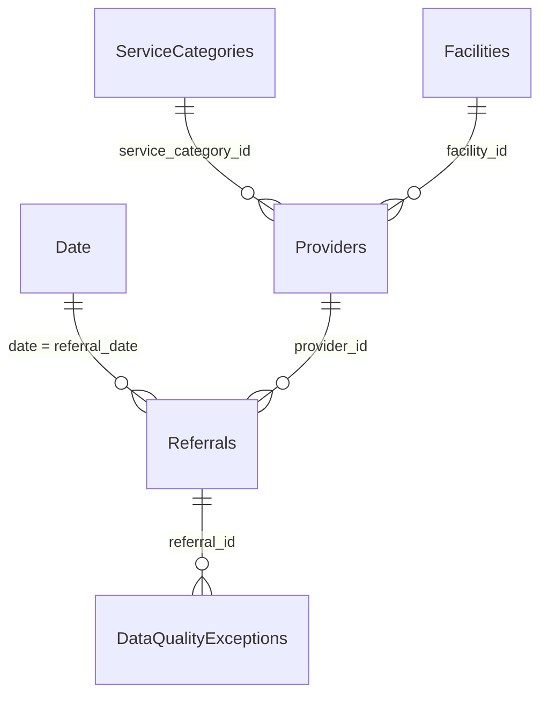

# Power BI Data Model

> **Synthetic data only.** Every value comes from the project's generator. Nothing
> describes real patients, providers or facilities. This model is for portfolio and
> educational use only, not for clinical decision-making.

This document specifies the import-mode model to build in **Power BI Desktop** from the six
CSV files in `powerbi/data/`. The step-by-step clicks are in
[POWER_BI_BUILD_GUIDE.md](POWER_BI_BUILD_GUIDE.md), and every column is described in
[DATA_DICTIONARY.md](DATA_DICTIONARY.md). The model is built by hand. No script creates
it.

## Tables

| Power BI table | Source file | Role | Grain (one row per) | Rows (seed 42) |
|---|---|---|---|---|
| Referrals | `referral_journey.csv` | Fact | processed referral | 147,750 |
| DataQualityExceptions | `data_quality_exceptions.csv` | Detail (many side of Referrals) | Phase 2 data-quality exception | 11,116 |
| Providers | `providers.csv` | Dimension | provider | 132 |
| ServiceCategories | `service_categories.csv` | Dimension (filters Providers) | service category | 8 |
| Facilities | `facilities.csv` | Dimension (filters Providers) | facility | 12 |
| Date | `date.csv` | Date dimension | calendar day | 365 |

Rename each query to the name in the first column when you import it, because the DAX
measures in [dax_measures.txt](dax_measures.txt) use these names.

Referrals is the single referral-level fact table:
- **Patient segments are columns, not a table.** Age group, gender and insurance type sit
  on Referrals, so no patient table or patient ID is needed.
- **Appointments are already summarized.** Every appointment-level fact the dashboard
  needs is summarized per referral by the Phase 3 SQL, so no appointment table is
  imported. This also keeps referral counts at the correct grain.

## Relationships

Create exactly these five relationships, each with these settings:
- **Active**
- **One to many (1:\*)**
- **Cross-filter direction: Single**

| # | One side (filters) | Many side (is filtered) | Why it exists |
|---|---|---|---|
| 1 | `Date[date]` | `Referrals[referral_date]` | Filter and group referrals by day, month and quarter (Referral Date slicer, monthly charts) |
| 2 | `Providers[provider_id]` | `Referrals[provider_id]` | Each referral has one receiving provider (Provider slicer, provider charts and matrix) |
| 3 | `ServiceCategories[service_category_id]` | `Providers[service_category_id]` | Each provider offers one service category. Category reaches referrals through the provider |
| 4 | `Facilities[facility_id]` | `Providers[facility_id]` | Each provider works at one facility. Facility reaches referrals through the provider |
| 5 | `Referrals[referral_id]` | `DataQualityExceptions[referral_id]` | Each exception belongs to one referral, so every referral slicer also filters the exception chart |

### One side, many side and filter direction

- **One side:** the table where each key value appears once: one date, one provider, one
  service category, one facility, one referral.
- **Many side:** the table where the key repeats. For example:
  - one provider receives many referrals;
  - one service category or facility has several providers;
  - one referral can have several data-quality exceptions.
- **Filter direction:** filters flow from the one side to the many side only. They follow
  these chains:
  - Service Category / Facility → Providers → Referrals → DataQualityExceptions
  - Date → Referrals → DataQualityExceptions

### Why Service Category and Facility filter through Providers

A referral's service category and facility are always those of its receiving provider.
Phase 2 validates this, and fills any blank facility from the provider. So the snapshot
does **not** repeat `service_category_id` or `facility_id` on Referrals. Instead:

- **Category or Facility filters Providers, and Providers filters Referrals.** Selecting
  *Cardiology* keeps only Cardiology providers, which keeps only their referrals. The
  totals are identical to the Phase 3 service-category metrics.
- **The Provider slicer list follows the other slicers.** Slicers on the same page filter
  each other, so the Provider slicer shows only providers in the selected category or
  facility.
- **The reverse does not happen.** Selecting a provider does not shorten the Service
  Category slicer list, because filters do not flow from Providers up to ServiceCategories.
  This is intended: it keeps every filter direction single and predictable.
- **Facility works through the same chain.** The as-built Page 2 has a Facility slicer
  on `Facilities[facility_name]`. It filters Providers, and Providers filter Referrals,
  just as Service Category does.

### How ambiguity is avoided

- **One path per filter.** There is exactly one filter path from each dimension to
  Referrals. Do not add relationships from ServiceCategories or Facilities directly to
  Referrals. The snapshot leaves those keys off Referrals, so such a relationship cannot
  be created by mistake.
- **No bidirectional relationships.** Do not change any relationship to Both. In
  particular, do not make relationship 5 bidirectional. An exception filter would then
  flow back into Referrals and silently change every referral KPI.
  - **To slice referrals by data quality:** use `Referrals[has_data_quality_issue]`.
  - **To count exceptions:** use the Data Quality Exceptions measure.
- **No many-to-many relationships**, and no inactive relationships.
- **Turn off relationship autodetection** before importing, then delete any relationship
  Power BI creates that is not in the table above.

## Model settings

1. **Turn off Auto date/time.** Go to **File > Options and settings > Options > CURRENT
   FILE > Data Load** and clear **Auto date/time**. Turning it off matters for three
   reasons:
   - Auto date/time would build a hidden date table for every date column, including
     `first_contact_date`, `first_booking_date` and `first_appointment_date`. That
     enlarges the model.
   - It would offer duplicate date hierarchies.
   - It could group dates in ways that do not follow the marked Date table.
2. **Mark Date as the date table.** Select Date, then
   **Table tools > Mark as date table**, and choose `Date[date]`. The column is unique and continuous (one row per day
   of 2025), so Power BI accepts it.
3. **Set sort-by-column.** Select the column, then **Column tools > Sort by column**:

   | Column | Sort by |
   |---|---|
   | `Date[month_name]` | `Date[month_number]` |
   | `Date[year_month]` | `Date[year_month_sort]` |
   | `Date[weekday_name]` | `Date[weekday_number]` |
   | `Date[quarter_label]` | `Date[quarter_number]` |
   | `Referrals[primary_leakage_reason]` | `Referrals[leakage_reason_priority]` |

   Each pair is one-to-one, which Power BI requires.
4. **Hide technical fields** after the relationships exist: right-click > **Hide in report
   view**. Measures still use hidden columns.

   | Table | Hide |
   |---|---|
   | Referrals | `referral_id`, `referral_date`, `provider_id`, `leakage_reason_priority`, every `*_flag` column, `has_data_quality_issue`, `duplicate_record_count`, `data_quality_issue_count`, `first_contact_date`, `first_booking_date`, `first_appointment_date`, `days_to_first_contact`, `days_to_schedule`, `days_to_first_appointment` |
   | DataQualityExceptions | `exception_id`, `referral_id`, `entity_type`, `issue_type`, `field_name` |
   | Providers | `provider_id`, `facility_id`, `service_category_id` |
   | ServiceCategories | `service_category_id` |
   | Facilities | `facility_id` |
   | Date | `month_number`, `year_month_sort`, `weekday_number`, `quarter_number` |

   The fields left visible are:
   - **Referrals:** `referral_source`, `urgency`, `insurance_type`, `age_group`,
     `gender`, `referral_status`, `outcome`, `primary_leakage_reason`;
   - **DataQualityExceptions:** `issue_label` and `resolution_status`;
   - **dimensions:** the name and attribute columns;
   - **Date:** `date`, `year`, `quarter_label`, `month_name`, `year_month`,
     `week_number`, `day_of_month`, `weekday_name`, `is_weekend`.
5. **Formats and summarization:**
   - **Dates:** `Date[date]` and the Referrals date columns use the Date type, displayed
     as `yyyy-mm-dd` or short date.
   - **Don't summarize:** set **Column tools > Summarization > Don't summarize** on all
     Date number columns, `ServiceCategories[target_days_to_appointment]`, and every
     flag, count and duration column in Referrals. Totals and rates come only from the
     DAX measures.
   - **Measure formats:** these are listed in `dax_measures.txt`:
     - counts: `#,0`;
     - rates: `0.0%`;
     - medians: `0.0`.

## Data types

These are the import types:
- **Text:** every ID, name and category column.
- **Date:** `Date[date]` and the four Referrals date columns.
- **Whole number:** every flag, count, duration, priority and Date number column.

[DATA_DICTIONARY.md](DATA_DICTIONARY.md) lists each column's type.

## Measures and grain

- **Referral counts:** every count measure counts **Referrals rows**, so each referral is
  counted once, whatever its number of appointments.
- **Exceptions:** Data Quality Exceptions counts exception rows, which is a different
  grain. Its label makes that clear.
- **Rates:** all four rates divide by Total Referrals with `DIVIDE`.
- **Medians:** the medians ignore blank durations.
- **Conversion plus leakage:** the two rates are not expected to sum to 100%, because
  active referrals are neither.
